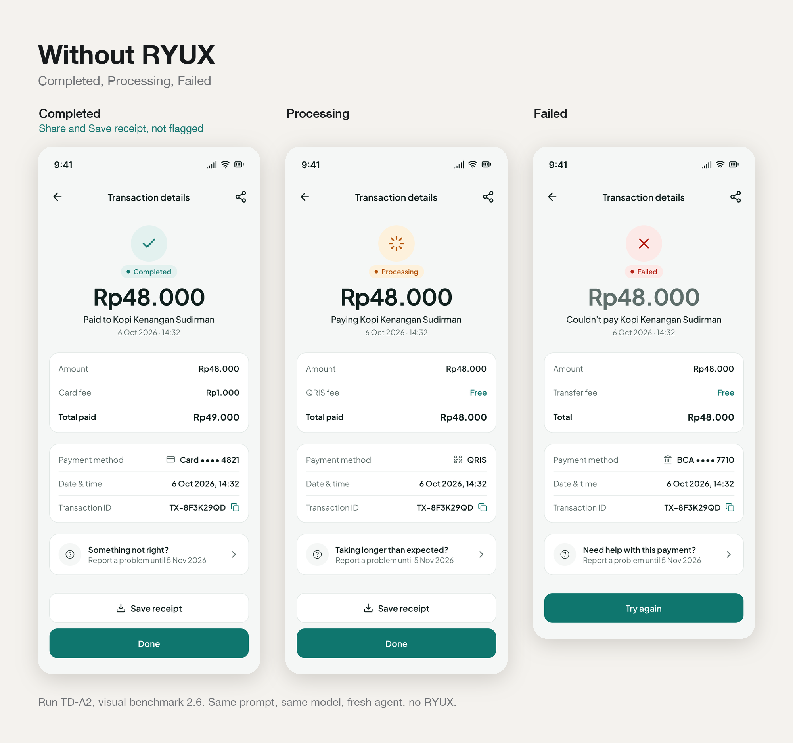
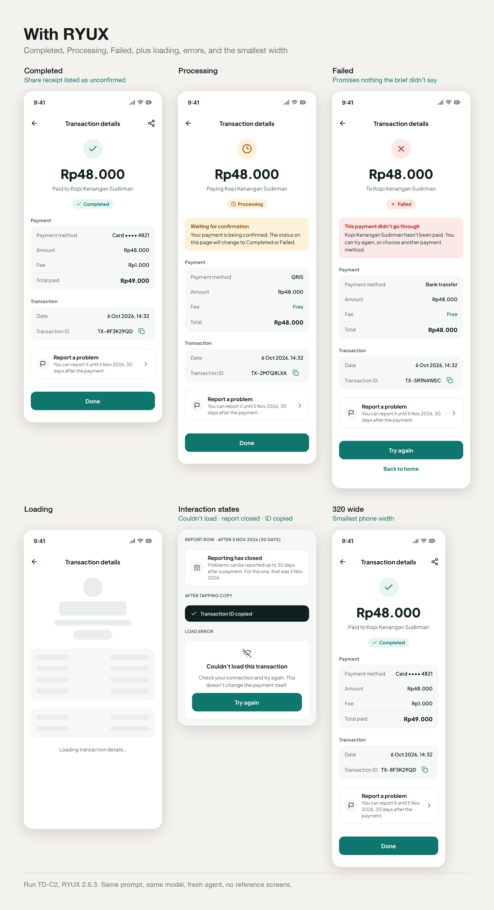
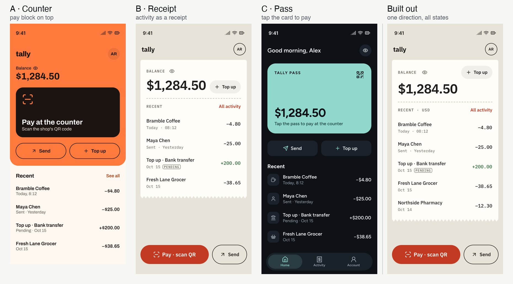
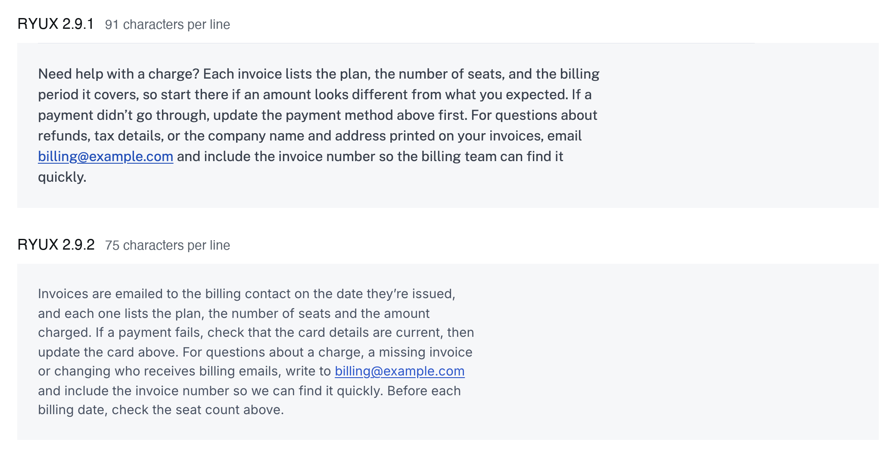

<p align="center">
  <a href="https://www.npmjs.com/package/@ryuxdsgn/design-intelligence"></a>
  <a href="https://github.com/ryuxdsgn/design-intelligence/actions/workflows/ci.yml"></a>
  <a href="LICENSE"></a>
</p>

# RYUX

**Understand before you design.**

An open-source design intelligence layer for AI agents. See what changes when AI has better design
context.

```bash
npx @ryuxdsgn/design-intelligence
```

**[See the difference](#see-the-difference)** · **[Latest designs](#latest-designs)** · **[Get started](#get-started)** · **[Benchmarks](docs/benchmarks/)**

## The problem

AI can generate an interface in seconds. The hard part is everything around it: what the screen
should contain, which states it needs, which rules are real, and which details were never decided.
A fast answer fills those gaps silently, so the result looks finished and is partly made up.

RYUX works out what the agent knows, what it is guessing, and what nobody told it. Then it decides,
and keeps the open questions visible instead of filling them in.

## See the difference

Same brief, same agent, one with RYUX: the transaction detail screen of a wallet called Lumo, shown
after the user pays, with its currency, statuses, fee, and 30-day reporting window. Designed in pen.dev.

<a href="apps/web/public/proof/lumo-without.png"></a>

<a href="apps/web/public/proof/lumo-with.png"></a>

Three runs each, a fresh agent per run, same model:

| | Without RYUX | With RYUX |
| --- | --- | --- |
| States designed | Completed, Processing, Failed | Those three plus loading, couldn't load, report window closed, and 320 wide, in 3 of 3 |
| Actions the brief didn't mention | Added and presented as given, in 3 of 3 | Proposed and listed as unconfirmed, in 3 of 3 |
| Promises the brief didn't make | "No money was taken" on a failed payment, in 2 of 3 | None, in 3 of 3 |

The difference is what the screens cover and what they claim.
[Brief, method, and every run](docs/benchmarks/lumo-td-2.6/).

## Latest designs

Rated blind by a product designer with nine years of experience: sides shuffled, nothing labeled.

**Three directions before one design.** On an expressive surface, RYUX renders three structurally
different directions, rates them against the brief, and lets you pick. In the rating, the options
were real choices in 2 of 3 sets.

<a href="docs/benchmarks/explore-judge/three-directions.png"></a>

**Type that is set, not only sized.** RYUX 2.9.2 keeps paragraphs at 45 to 75 characters per line,
takes line-height from size, and limits weights and families. On the same Billing page, the
designer shipped the 2.9.2 version in 2 of 3 pairs.

<a href="docs/benchmarks/typo-craft/typography-measure.png"></a>

Details, the next change (motion), and every image: [explore, judge, critique](docs/benchmarks/explore-judge/)
and [typography](docs/benchmarks/typo-craft/).

## What makes it different

**It knows what it knows.** Before it designs, RYUX sorts what it is working with:

- **Known**: stated in the prompt, DESIGN.md, or your product docs, or seen in the design itself.
- **Design assumptions**: low-risk choices made from the context, written down.
- **Unconfirmed capabilities**: actions products like yours usually have, such as sharing a
  receipt. RYUX may propose one, and lists it as unconfirmed.
- **Facts, policies, and claims**: fees, refund times, guarantees. Never invented.

**Decisions come with a receipt.** For each major choice, RYUX writes down what it decided, on what
evidence, and how sure it is. This one is quoted from a benchmark run:

```
Decision     Amount + Fee = Total paid, shown in the card
Evidence     None
Confidence   Low
Assumption   [CONFIRM] The fee is charged on top of the amount.
             If the fee is taken out of the amount instead, the rows change.
```

**It checks what it made.** It renders the result, counts what can be counted (accent colors, type
weights, radii, labels for the same action), checks hierarchy, and closes with a report of what was
verified and what was not.

## How it works

Tell the agent what you are doing, in your own words. RYUX picks the step and reads only the design
knowledge that step needs.

```text
Analyze this checkout screen (screenshot attached).                → Analyze
Design the transaction detail screen for our wallet, in pen.dev.   → Design
Build this design in our React app.                                → Build
Critique our pricing page at https://example.com/pricing.          → Critique
QA the build against the design at 390 and 320 wide.               → QA
```

RYUX reads DESIGN.md and your product docs first, and asks only what would change the design: at
most three questions, often none. Recipes and a full five-step session: [Prompting RYUX](GUIDE.md#prompting-ryux).

## Get started

```bash
npx @ryuxdsgn/design-intelligence
```

It asks which agents you use, installs RYUX, then offers a short project setup that writes
DESIGN.md. Run `npx @ryuxdsgn/design-intelligence setup` again any time to change the answers.

Any agent, through [skills.sh](https://skills.sh):

```bash
npx skills add ryuxdsgn/design-intelligence
```

As a Claude Code plugin, inside Claude Code:

```text
/plugin marketplace add ryuxdsgn/design-intelligence
/plugin install ryux@design-intelligence
```

RYUX works on its own. The hosted RYUX MCP for reference screens is coming; you can run the server
locally with sample data ([`apps/mcp/README.md`](./apps/mcp/README.md)). The [guide](GUIDE.md)
covers other agents, global installs, updates, and the MCP.

## Benchmarks

Every claim above comes from a run you can read in full. Each benchmark fixes its criteria before the
first run, uses a fresh agent per run, and keeps the raw outputs.

| Benchmark | What it shows | Runs |
| --- | --- | --- |
| [Lumo transaction detail](docs/benchmarks/lumo-td-2.6/) | More states covered, no invented actions or promises | 3 + 3 |
| [Typography](docs/benchmarks/typo-craft/) | Line length and type restraint, measured in the render; scorer included | 3 + 3 |
| [Explore, judge, critique](docs/benchmarks/explore-judge/) | Three directions, a hierarchy pass, recorded motion | 3–6 per condition |
| [Five steps on one screen](docs/benchmarks/case-td-2.6/) | Analyze → Critique → Design → Build → QA in one session | 1 |
| [Scenarios](docs/benchmarks/scenarios/) | Repeatable tasks with a weighted rubric | 1 + 1 each |

The typography benchmark runs end to end with one command and a scorer:
[run it yourself](docs/benchmarks/typo-craft/#run-it-yourself). Results are counts from a few runs on
one model; the [showcase](docs/showcase.md) reads them in context.

<details>
<summary><b>Technical details</b></summary>

### What gets installed

One skill folder, `ryux/`: a router (`SKILL.md`) that picks the step, five capability files, and
the knowledge modules those steps read. Rules have levels (Required, Preferred, Contextual) and a
few Hard Gates that are never waived, such as no invented numbers and no missing critical states.
Browse them in [`skills/ryux/`](./skills/ryux) and [`docs/design-rules.md`](./docs/design-rules.md).

### MCP tools

Nine tools: research (`search_screens`, `get_flow`, `get_local_pattern`, `compare_apps`,
`extract_design_direction`) and review (`audit_ui`, `audit_copy`, `heuristic_eval`,
`delivery_gate`). See [`apps/mcp/README.md`](./apps/mcp/README.md).

### Reference data

RYUX may use reference screens and product evidence during analysis. Private reference data is not
included in this repository; the repository contains the schemas, rules, and tooling used to work
with evidence.

### Repository

```
apps/mcp/         MCP server (Cloudflare Workers)
apps/web/         ryux.design (Next.js)
packages/core/    shared tool logic
packages/cli/     the ryux CLI (npx @ryuxdsgn/design-intelligence)
skills/ryux/      the RYUX skill, generated from packages/cli/src
docs/             design rules, taxonomy, showcase, benchmarks
```

```bash
pnpm install
pnpm dev:mcp        # MCP server, local (see apps/mcp/README.md)
pnpm dev:web        # ryux.design on http://localhost:3000
pnpm typecheck
```

### Further reading

- [GUIDE.md](GUIDE.md): install, MCP, and how RYUX reasons
- [docs/design-rules.md](docs/design-rules.md): every rule, level, and gate
- [docs/showcase.md](docs/showcase.md): every case, in context
- [docs/benchmarks/](docs/benchmarks/): every raw run, and how to run one yourself
- [DEPLOY.md](DEPLOY.md): run your own instance (database, MCP server, website)

</details>

## Contributing

Issues and pull requests are welcome on [GitHub](https://github.com/ryuxdsgn/design-intelligence).
Rules and skills are generated from `packages/cli/src`; run `pnpm sync:skills` after changing them.
Designers who want to rate the next blind round: open an issue and say so. To report a
vulnerability, see [SECURITY.md](./SECURITY.md).

## Status and license

RYUX 2.9, early access, free. Available now: the skill, the CLI, skills.sh, the Claude Code plugin,
and the MCP server run locally. Coming: the hosted MCP and a larger reference library.

**MIT**, © 2026 ryux.design (see [LICENSE](./LICENSE)). The code and the RYUX skill are covered by
this license. The reference data and the hosted service are separate.

Assets in this repository are synthetic outputs and illustrations created for RYUX experiments and
its website, unless otherwise noted. Brand names may appear as text in mock interfaces and do not
indicate affiliation.
